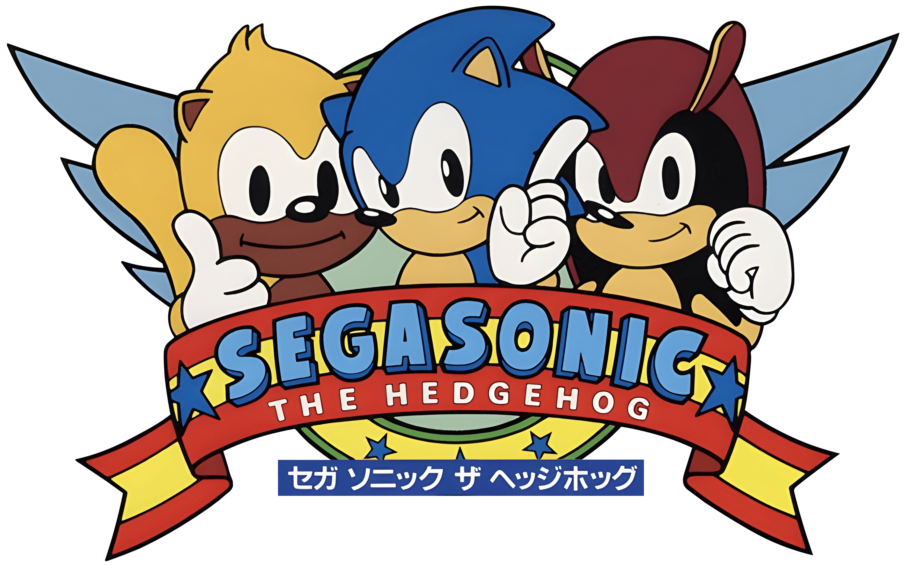
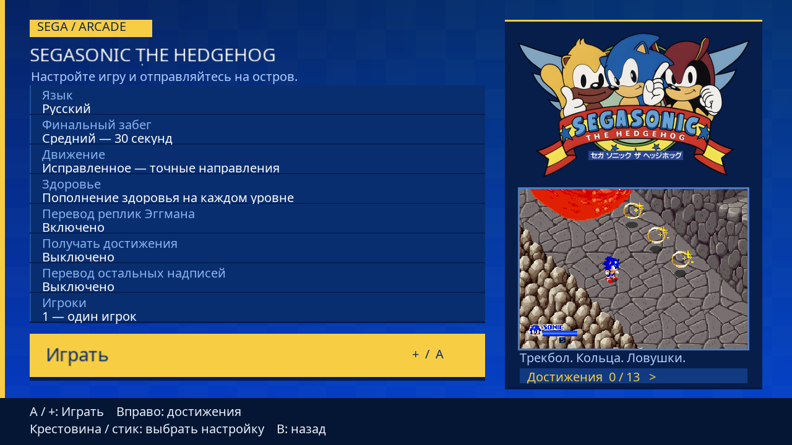
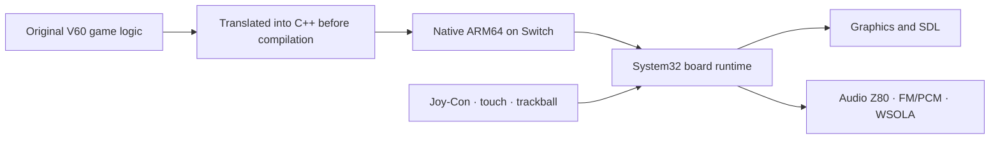

<div align="center">



# SegaSonic · Native Switch

**Trackballs. Rings. Eggman's traps. Now on Nintendo Switch.**


**Native ARM64 · Static V60 recompilation · EN / RU launcher · HOME menu tile**

[Quick start](#quick-start) · [Two players](#two-players--two-joy-con) · [Features](#features) · [How it works](#how-it-works) · [Audio](#known-audio-issue)

</div> 

---

## Tested on Switch OLED

**The entire main campaign is playable: a tester confirmed 100% completion on a real Nintendo Switch OLED**, including level transitions and the final tower escape.

That complete playthrough used **version 21**. This package contains **version 21**, which adds local two-player controls and updated audio delivery. Automated checks verified independent inputs and two characters running in the actual game logic. A complete two-player playthrough and version 21 audio quality on hardware still need testing. The 100% badge refers to campaign completion, not freedom from every defect.

| Check | Status |
|:--|:--|
| Complete baseline campaign on Switch OLED | **Confirmed by the tester** |
| Two characters with separate trackballs and buttons | **Confirmed by the tester** |
| Arcade / Fixed, God mode, Health++, achievements, escape timer | **Confirmed by the tester** |
| EN / RU text and saved settings | **Confirmed by the tester** |
| Version 21 split Joy-Con controls and audio on physical Switch | **Confirmed by the tester** |

## Quick start

The package includes **two NRO files**:

| File | Purpose |
|:--|:--|
| [`segasonic-home.nro`](segasonic-home.nro) | **Game and launcher in one file**, launched from Homebrew Menu or its HOME tile. |
| [`segasonic-home-setup21.nro`](segasonic-home-setup21.nro) | **Forwarder installer**, which creates a SegaSonic HOME tile with the game icon. |

Copy both files to:

```text
SD:/switch/segasonic/
├── segasonic-home.nro
├── segasonic-home-setup21.nro
└── userdata/                    # created automatically
```

Open **SegaSonic21** in Homebrew Menu, choose your launcher settings, and press **A** on **Play**. **+** starts the game from any launcher panel. Touch controls are also supported.

`userdata` stores settings, achievements, and diagnostic logs. Keep this folder when updating.

### Add a tile to the regular HOME menu

1. Hold **R** while launching an installed game. Keep holding R until Homebrew Menu appears. This enters application mode with full memory access.
2. Open **SegaSonic HOME Setup21**.
3. Press **A** and wait for **SUCCESS**.
4. Press **+**, return to HOME, and open **SegaSonic The Hedgehog**.

The tile opens the same launcher. No separate game installation is required. Application-mode launch instructions are also available in the [HomeTile documentation](https://github.com/Amir-Ehsani/HomeTile-switch#launching-hometile).

**The installer cannot run through Album:** it will show the R-button instructions. It generates the installation package on the console; no key files are required. After installation, a backup package is saved as `switch/segasonic/SegaSonic-HOME21.nsp`. This NSP does not exist before the installer is first run.

The HOME tile targets this permanent path:

```text
sdmc:/switch/segasonic/segasonic-home.nro
```

### Update without running the installer again

1. Close the game.
2. Replace **only** `SD:/switch/segasonic/segasonic-home.nro` with the new file of the same name.
3. Keep `userdata/` intact.
4. Launch the existing SegaSonic HOME tile.

**Do not rename the game after installing the tile.** An existing version 19 forwarder targeting this same path can stay installed. Replacing the game does not require running `segasonic-home-setup21.nro` again.

## Two players · two Joy-Con

Select **Players → 2 — two Joy-Con** in the launcher.

**Detach both Joy-Con before pressing Play.** Hold each one **horizontally**, with the stick on the left and the four face buttons on the right. One standard pair becomes two controllers. If the controllers are already connected separately, system player slots **1** and **2** are used.

| On each Joy-Con | That player's action |
|:--|:--|
| Stick | Trackball direction and rotation speed |
| Any of the four buttons under the right thumb | Jump / confirm character selection |
| **SL** | Insert coin |
| **SR** | Start / join / continue |
| **SL + SR + stick click** | Exit the game |

**Starting together:** each player presses SL, then SR, selects a character, and confirms with a jump button. Original characters **Sonic, Ray, and Mighty** are available; choose two different characters.

More stick deflection means faster trackball rotation. Small movements allow precise positioning; full deflection allows fast running and climbing slopes. Each player has independent trackball counters, jump, coin, and Start inputs. Simultaneous inputs stay separate.

For solo play, select **Players → 1**. With a paired Joy-Con set or Pro Controller: stick moves, A jumps, − inserts a coin, and + starts. Touchscreen swipes imitate trackball rotation; in two-player mode, touch controls player one.

## Features

### A launcher with SEGA character

A blue and gold interface with the original logo, a game preview, clear selection focus, controller navigation, and touch support. The launcher, game, font, and artwork are embedded in a single game NRO. The interface switches between **English** and **Russian**.



<sub>Version 21 screenshot captured during automated testing of the project's SDL interface on PC.</sub>

### Arcade / Fixed movement

- **Arcade:** original arcade movement.
- **Fixed:** corrected diagonal movement without reducing trackball strength. Speed needed for slopes and quicksand is preserved. The correction applies to both players in two-player mode.

### Final escape difficulty

Difficulty changes **the final escape time**, including both the actual game timer and its visible countdown. Other level parameters retain their original behavior.

| Difficulty | Time |
|:--|--:|
| Easy | **60 seconds** |
| Medium | **30 seconds** |
| Normal | **20 seconds**, original timing |
| Hard | **15 seconds** |

### Health modes

- **Normal:** original damage and health carried between levels.
- **God mode:** damage does not reduce health.
- **Health++:** restores health when entering a new level; damage still matters within that level.

In two-player mode, modifiers apply to both participating players. The unused third player slot is untouched.

### Text translation: two independent options

**Eggman dialogue translation** translates nine existing Japanese text messages into the launcher language, including two-line panels and their opening/closing animation states. **Original voices are preserved; voice subtitles are not added.**

**Other text translation** is a separate option, **off by default**. With Russian selected, it translates the main level results, rings, start, player selection, and continue panels. Numbers remain the real game counters. With English selected, the original English artwork is retained. Character names, the logo, and original developer credits are preserved.

### Achievements

**13 achievements**, persistent progress, a launcher list, and notifications over gameplay without pausing:

- Clear the introduction and each of the seven main stages.
- Collect **100 / 200 / 300 rings in one game**. Two-player mode counts the participating players' combined collection, including original bonuses.
- **I Love Risk:** escape the tower with one second remaining.
- **No Rush:** escape with at least 20 seconds remaining.

The achievement option disables new unlocks and notifications while retaining previously earned achievements. Names and descriptions follow the launcher language.

## How it works

This is a dedicated port of **SegaSonic The Hedgehog (Sega System 32, 1993)** built through static recompilation of the main **NEC V60** CPU.

Discovered ROM instructions are translated into C++ before compilation. On Switch, that code becomes **native ARM64**. The main V60 does not decode instructions during gameplay and has no fallback interpreter. Unknown code addresses stop execution with diagnostics.



The original game defines levels, characters, and events. A dedicated runtime handles memory, interrupts, graphics, sound, and input. System32 graphics algorithms build on the work of BSD-licensed MAME component authors; the MAME framework itself is not running. Platform output uses **SDL2/libnx**.

The architectural boundary matters: the main V60 is recompiled, but the auxiliary audio **Z80 runs through an instruction-level core**. FM/PCM sound devices are modeled in software. Native execution of the main game does not mean that the Z80 and every arcade hardware device have been rewritten as conventional game logic.

## Known audio issue

**Audio can sometimes sound unusual or distorted.** The tester reported frequent distortion in the previous build. Full campaign completion was still confirmed.

Version 21 changes audio delivery: stereo **WSOLA** adjusts sound duration during frame-rate drops while preserving pitch, replacing playback-speed changes. Test-tone pitch, channel synchronization, and recovery after stalls were checked. This addresses one identified cause of distortion, but **clean audio on a physical console has not yet been verified for the new version**. Heavy scenes may still produce artifacts or interruptions.

## AI Assisted

Development involved substantial assistance from **AI / Codex**, including code research, static recompilation generators, the runtime, transition fixes, controls, the launcher, translation, achievements, and verification.

Feature decisions and real gameplay testing were performed by a human. Complete OLED campaign verification comes from the tester playing on real hardware. Automated checks supplement that result and do not replace it.

## Diagnostics and updates

| File | Contents |
|:--|:--|
| `userdata/launcher.ini` | Launcher settings |
| `userdata/achievements.ini` | Unlocked achievements |
| `userdata/native-run.log` | Build, frames, performance, and audio |
| `userdata/native-errors.log` | Game runtime errors |
| `userdata/home-forwarder21.log` | HOME tile installation steps |

These files live beside the game NRO in `switch/segasonic/userdata/`. When reporting a problem, include the logs and your player, movement, and health modes. Update by replacing `segasonic-home.nro`; retain your settings and achievements.

## Components and credits

SegaSonic, its characters, original graphics, music, and trademarks belong to **SEGA**. Thanks to the authors of **MAME System32 / V60**, **ymfm**, **fastz80 / chips**, **SDL2**, **libnx / devkitPro**, **Noto Sans**, **Sphaira**, **HomeTile**, and **switch-nsp-forwarder**.

The HOME installer is a separate **GPL-3.0** component. Component licenses and artwork provenance are included in [`licenses/`](licenses/). AI assistance does not replace attribution to third-party authors.

---

<div align="center">

**Choose your hero. Roll the trackball. Escape the island.**

*Nintendo Switch OLED · Campaign fully cleared · SegaSonic Native21*

</div>
